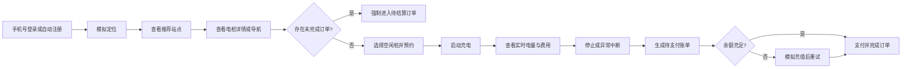
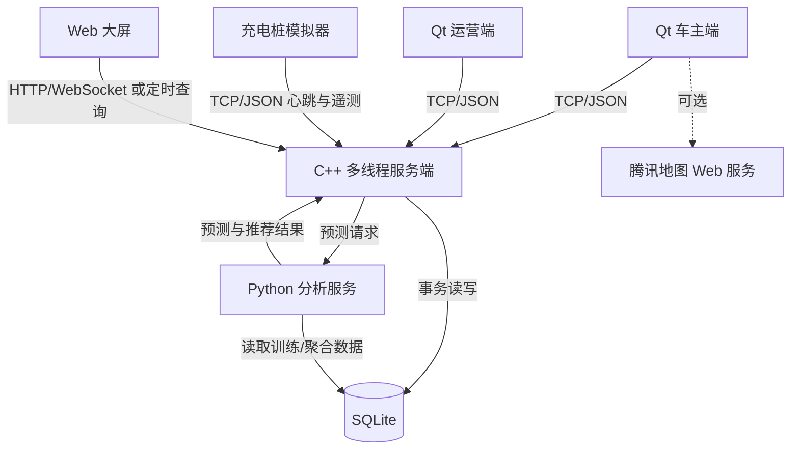

# 东软电动汽车充电桩应用管理平台

## 综合实训深化方案（设计评审稿）

> 适用条件：2026年9月3日至17日，约14个自然日、3人学生团队
> 基础依据：《01.项目说明书-东软电动汽车充电桩应用管理平台.doc》及项目参考图片
> 设计原则：基础业务闭环优先，创新功能少而完整，所有成果必须能够运行、演示和验收
> 当前状态：总体设计已确认；详细实施计划已完成

---

## 1. 项目定位

### 1.1 建设目标

本项目面向电动汽车车主、充电站运营人员和运营决策人员，建设一套覆盖“找桩—导航—预约—充电—计费—结算—运维—分析”的教学型充电桩管理平台。

项目首先服务于课程实训目标：完整经历需求分析、总体设计、详细设计、开发、测试和发布过程；掌握 Ubuntu 环境下的 Qt/C++ 开发、SQLite 数据管理、多线程和 Socket 通信；培养团队协作、问题定位、质量控制和成果表达能力。

项目不是商业充电平台，也不连接真实充电设备、真实支付、电网结算或真实车辆。涉及充值、充电、远程重启、设备遥测和地图定位的功能均为软件模拟。答辩时必须主动说明这一边界，避免把演示能力描述成真实生产能力。

### 1.2 现实问题

方案围绕以下实际生活情境展开：

1. 车主到达充电站后才发现没有空闲桩，产生额外等待和绕行。
2. 充电站价格、距离、空闲情况分散，用户难以快速比较。
3. 充电过程中断网、设备异常或余额不足时，订单容易出现状态不一致。
4. 运营人员能看到设备故障，却缺少从告警到处理完成的追踪过程。
5. 运营数据只用于展示，未能进一步形成拥堵预测和分流建议。

### 1.3 成功标准

项目完成时应同时满足以下条件：

- 一笔充电订单可以从预约开始，经过充电、计费、支付，最终完成结算，并可在用户端、运营端和数据库中追踪。
- 用户端、运营端和 Web 大屏对同一订单、电桩和营收数据的显示一致。
- 网络超时、重复请求、地图不可用、余额不足和设备异常均有明确处理结果，不产生重复扣费或无法解释的订单。
- 负荷预测和推荐结果可复现、有比较基线，并能解释推荐原因。
- 异常能够生成告警和工单，经过管理员处置后关闭并保留记录。
- 按最终演示剧本连续运行两遍，不出现阻断主流程的问题。

---

## 2. 范围与优先级

### 2.1 必须完成（P0）

P0 是课程说明书要求和最终验收底线。任何 P0 未完成时，不得投入时间扩展研究型功能。

| 领域 | 必须完成的内容 |
| --- | --- |
| 车主端 | 手机号登录/自动注册、个人信息、模拟充值、附近站点、站内电桩、地图导航、预约、充电、计费、结算、未结订单拦截 |
| 运营端 | 管理员登录、营收指标与趋势、电桩状态、充电桩管理、远程重启、充电站管理、用户搜索与冻结/解冻 |
| 服务端 | 多线程 Socket、统一报文、身份与权限检查、订单状态控制、异常处理、操作日志 |
| 数据库 | 管理员、用户、站点、电桩、订单、充值/支付、设备遥测、告警与工单等数据的持久化 |
| Web 大屏 | 核心运营指标、设备状态、站点负荷、营收趋势、告警事件和预测结果 |
| 智能分析 | 未来 1/6/24 小时负荷和空闲桩预测；结果返回用户推荐和运营预警 |
| 工程交付 | 建库脚本、演示数据、配置说明、启动说明、测试记录、需求对应表、演示剧本和实训报告 |

### 2.2 重点创新（P1）

14天内只做两项创新，并要求形成完整闭环。

#### 创新一：可解释的智能推荐与错峰引导

系统不再只按距离推荐充电站，而是综合距离、当前空闲率、充电价格和预测拥堵程度形成推荐分数。用户可以看到“距离近”“预计等待短”“价格较低”“未来一小时较空闲”等推荐理由。高峰时段，系统优先提示邻近且预计空闲的站点，减少排队和无效绕行。

建议初始权重：距离 30%、当前/预计等待 30%、价格 20%、预测负荷 20%。所有指标先归一化，再计算总分。权重写入配置文件，答辩时可现场调整并解释结果变化。

验收要求：同一组输入得到相同结果；推荐列表至少展示前 3 个站点及主要理由；关闭预测服务后仍能按距离、空闲率和价格完成基础推荐。

#### 创新二：设备异常告警与工单闭环

桩模拟器定时上报心跳、温度、电压、电流、功率和累计电量。心跳超时、温度越界或通信错误触发告警；系统自动建立工单，管理员可以确认、远程重启、填写处理说明并关闭工单。大屏展示未处理告警数量和最新事件。

验收要求：能够模拟至少三类异常；告警、工单、管理员操作和最终结果可以按时间顺序追踪；异常中断充电时按实际电量生成待结算订单，不直接丢弃订单。

### 2.3 可选增强（P2）

仅在 P0 和 P1 全部通过后选择实现：

- 个人充电量和估算减排展示。换算系数必须注明数据来源和“仅作教学估算”。
- 预约到期提醒、常用站点收藏、订单电子凭证。
- 大屏主题切换、告警声音提示和演示模式。

### 2.4 不纳入本期交付

以下内容保留为报告中的后续研究方向，不进入当前必交范围：

- 真实银行卡、微信或支付宝支付。
- 真实充电枪、车辆电池管理系统或电网调度。
- 真实 V2G 放电和车网收益结算。
- 完整 OCPP 网关及与商业运营商的对接。
- Redis 集群、微服务拆分、容器编排和高可用部署。
- LSTM 等深度学习模型和“精准预测”宣传。

### 2.5 两阶段验收边界

课程项目只有约14个自然日、11个工作日，按两个各约一周的阶段验收：

| 阶段 | 时间 | 验收主题 | 必须独立成立的结果 |
| --- | --- | --- | --- |
| 第一阶段：基础系统 | 9月3～9日开发，9月10日验收 | 全部Qt窗口、浅色Web大屏、服务端、SQLite和模拟充电业务闭环 | 主要界面全部完成并使用 `SIMULATED` 数据；不启动分析服务也能完成登录、找站、预约、模拟充电、计费、结算及运营核对 |
| 第二阶段：真实数据与大数据分析 | 9月11～16日开发，9月17日全量验收 | 在第一阶段界面上接入真实匿名或公开聚合数据，完善治理、分析、预测、推荐和回算 | 不重新制作或删除第一阶段界面；结果可追溯到来源和批次；停止分析服务后第一阶段功能仍不退化 |

第一阶段不是只完成界面。它必须提前冻结第二阶段的数据衔接契约：稳定业务编号、事件发生时间与导入时间、时区、金额/电量/时长单位、数据模式、数据集版本、导入批次和只读导出格式。第二阶段可以新增分析字段，但不得改变第一阶段订单、余额、设备和工单字段的原意。

“真实数据”仅指来源明确、允许教学分析且已经匿名化的历史数据或公开聚合数据，不代表连接真实充电桩、真实车辆、真实支付或电网控制。模拟数据、真实匿名数据和公开聚合数据必须分别标记为 `SIMULATED`、`REAL_ANONYMIZED` 和 `PUBLIC_AGGREGATED`，不得混合后统一宣称为真实数据。

---

## 3. 用户、场景与核心流程

### 3.1 主要角色

| 角色 | 目标 | 主要操作 |
| --- | --- | --- |
| 车主 | 快速找到合适的空闲桩并顺利完成充电 | 登录、找站、比较、导航、预约、充电、结算、查看订单 |
| 运营管理员 | 掌握经营与设备状态，及时处置异常 | 查看营收、管理站点和电桩、冻结用户、重启设备、处理工单 |
| 运营决策人员 | 快速了解全局负荷和风险 | 查看大屏、负荷预测、站点排行、告警和分流建议 |
| 实训教师/评审人员 | 验证功能、技术和工程过程 | 按验收用例操作系统、查看数据与测试证据 |

### 3.2 车主正常充电流程



### 3.3 异常处置流程


---

## 4. 系统总体设计

### 4.1 模块边界

系统划分为五个可独立开发和验收的模块。原说明书将大屏与机器学习分别描述，但为了控制14天工作量，本方案把机器学习作为“数据分析服务”，与大屏共同组成数据分析模块，不再额外扩张为一套独立平台。

| 模块 | 主要职责 | 不承担的职责 |
| --- | --- | --- |
| Qt 车主端 | 交互、输入校验、状态展示、请求服务端 | 不直接修改数据库，不自行决定订单最终状态 |
| Qt 运营端 | 后台管理、统计展示、告警与工单处置 | 不绕过服务端直接控制订单和设备 |
| C++ 服务端 | 网络通信、权限、业务规则、订单状态、事务、日志 | 不承担复杂界面展示 |
| SQLite 数据库 | 保存业务事实和操作记录 | 不在表中写复杂业务判断 |
| Web 大屏与 Python 分析服务 | 统计展示、预测、推荐结果和预警 | 不直接处理扣费和订单状态变更 |

### 4.2 部署关系



### 4.3 技术基线

- 操作系统：VMware 17 + Ubuntu 22.04 LTS 或以上。
- Qt/编译：Qt Creator 6.2 或以上、Qt Widgets、Qt Network、Qt SQL、Qt Charts、Qt WebEngineWidgets、C++17。
- 数据库：SQLite。当前阶段不同时兼容 MySQL，避免两套语法和部署方式分散精力。
- 服务端：Qt `QTcpServer` 或 POSIX Socket；主线程监听，工作线程处理连接或请求；线程不得共享同一个 SQLite 连接。
- Web 大屏：Vue 3 + ECharts，数据量较小时允许使用定时查询；只有实时联动稳定后再使用 WebSocket。
- 数据分析：Python、pandas、scikit-learn；首选可解释、训练成本低的基线模型。
- 地图：腾讯地图 Web API；密钥通过本地配置文件或环境配置读取，不写入公开源码。

---

## 5. 功能需求与验收条件

### 5.1 Qt 车主端

#### F-U01 手机号登录与自动注册

- 输入 11 位手机号；格式错误时不发送请求并显示明确提示。
- 已存在用户直接登录；不存在用户自动创建，昵称为“用户+手机号后四位”，使用默认头像。
- 说明书要求免密登录，本项目按教学要求实现，但明确标注其不适合真实生产环境。
- 冻结用户登录后进入受限模式：不能预约或发起新充电，但可以查看历史订单、处理充电中订单并完成结算。

验收：合法新手机号首次登录后数据库新增一条用户记录；再次登录不重复创建；非法手机号和冻结用户得到不同提示。

#### F-U02 个人信息与模拟充值

- 展示头像、昵称和钱包余额。
- 支持选择本地 JPG/PNG 头像，限制文件类型和大小；保存到项目数据目录并使用生成的文件名。
- 支持修改昵称，去除首尾空格并限制长度。
- 模拟充值必须生成充值流水，余额由服务端事务更新，不能只改界面数字。
- 初始余额属于项目约定，建议设为 100 元，并在演示数据说明中注明。

验收：重启客户端后头像、昵称和余额仍存在；同一充值请求重复发送只记一次流水。

#### F-U03 附近站点与推荐

- 支持下拉选择示例区域或手动输入地址模拟定位。
- 地图接口可用时完成地址解析；不可用时使用预置示例坐标并提示降级状态。
- 站点卡片显示站名、价格、总桩数、空闲数、距离、预测繁忙程度和推荐理由。
- 可切换“距离优先”“价格优先”“智能推荐”。
- 点击站点查看电桩编号、快/慢充、功率和状态。

验收：相同位置和数据下排序结果稳定；地图断网时仍能使用预置站点完成主流程。

#### F-U04 一键导航

- 使用 `QWebEngineView` 打开腾讯地图路线规划页面。
- 起点为模拟当前位置，终点为目标站点；支持驾车/步行选择。
- 地图服务失败时显示站点地址和经纬度，提供复制信息，不影响充电业务。

#### F-U05 预约、充电、计费和结算

- 进入充电功能前查询未完成订单；存在充电中或待结算订单时强制进入相应页面。
- 只有空闲桩可预约，同一桩同一时刻只能存在一个有效预约或充电订单。
- 预约设定过期时间，过期后释放桩位。
- 桩模拟器定时上报功率、累计电量和设备状态，界面展示电量、时长和预估费用。
- 停止充电或异常中断后，以服务端记录的实际电量计算金额并生成待支付订单。
- 支付成功时，在同一事务内完成扣款、支付流水、订单完成和桩位释放。

验收：重复点击“开始充电”只创建一个有效会话；重复支付不重复扣费；客户端中途关闭再打开后能恢复正确订单状态。

### 5.2 Qt 运营端

#### F-A01 管理员登录

- 默认演示账号为 `admin`，初始密码按说明书设为 `123456`；部署脚本写入其摘要而不是明文，并在首次登录时提示修改。
- 数据库只保存密码摘要和随机盐，不保存明文密码。
- 登录失败提示不区分“账号不存在”和“密码错误”，服务端记录失败事件。

#### F-A02 销售业绩

- 展示今日、本月和累计营收。
- 使用 QChart 展示近 7 日/30 日趋势。
- 营收只统计支付成功的订单；取消和待支付订单不得计入。
- 指标与订单明细可核对，金额统一保留两位小数。

#### F-A03 电桩状态与管理

- 展示在用、空闲、故障、离线的数量和比例。
- 列表包含编号、站点、类型、功率、状态、累计次数和累计时长。
- 远程重启生成操作记录；桩模拟器回复成功后才更新状态，超时则生成告警。

#### F-A04 充电站管理

- 展示 ID、名称、地址、经纬度、总桩数和在线率。
- 点击站点查看站内电桩。
- 新增站点时校验必填项、坐标范围和电桩数量；站点创建与初始电桩创建使用同一事务。

#### F-A05 用户管理

- 展示用户 ID、遮盖后的手机号、昵称、余额、注册时间和状态。
- 支持手机号关键字搜索、冻结和解冻。
- 冻结操作记录管理员、时间和原因；冻结不应阻止用户结算已有订单。

#### F-A06 告警与工单

- 展示告警等级、设备、类型、发生时间、状态和关联订单。
- 告警自动建立工单；管理员可确认、处理、填写结果和关闭。
- 只有设备恢复或填写合理处理说明后才能关闭工单。

### 5.3 Web 大屏与数据分析

#### F-D01 运营大屏

- 顶部：累计充电量、服务车次、累计营收、设备在线率、未处理告警。
- 中部：站点位置与负荷；地图资源不可用时切换为站点排行列表。
- 趋势：24 小时实际负荷与预测负荷。
- 运营：站点利用率排行、充电时段分布、告警事件流。
- 数据更新时间和数据来源必须可见，避免把静态演示数据误认为实时数据。

#### F-D02 负荷与空闲桩预测

- 使用历史时段、充电量、订单数、星期、小时、节假日和模拟天气等特征。
- 输出未来 1/6/24 小时站点负荷、预计空闲桩和高峰时段。
- 训练集与测试集按时间先后划分，禁止随机打乱导致未来数据泄漏。
- 至少与“使用上一时段数值作为预测”的朴素基线比较，测试集 MAE 或 RMSE 更低时才宣称模型有效。
- 数据不足或模型文件缺失时，返回基线预测并显示降级标记，不生成随机数冒充预测。

#### F-D03 推荐与预警联动

- 服务端把当前站点状态、预测结果、价格和距离传入推荐计算。
- 预测高峰时向运营端发出负荷预警，向车主端标注预计拥堵并推荐邻近替代站点。
- 推荐结果记录输入摘要、总分和主要理由，便于演示和复查。

---

## 6. 订单状态与业务规则

### 6.1 状态定义

| 状态 | 含义 | 可进入的下一状态 |
| --- | --- | --- |
| `RESERVED` | 已预约，等待启动 | `CHARGING`、`CANCELED`、`EXPIRED` |
| `CHARGING` | 正在充电 | `PENDING_PAYMENT` |
| `PENDING_PAYMENT` | 已停止并生成账单，等待支付 | `FINISHED` |
| `FINISHED` | 已支付并完成 | 无 |
| `CANCELED` | 用户或管理员取消预约 | 无 |
| `EXPIRED` | 预约到期未启动 | 无 |

数据库只保存上述状态，不允许客户端任意写入字符串。所有状态变化由服务端检查当前状态、目标状态和操作人后执行。

### 6.2 关键规则

1. 一个用户同时最多有一个 `RESERVED`、`CHARGING` 或 `PENDING_PAYMENT` 订单。
2. 一个电桩同时最多属于一个 `RESERVED` 或 `CHARGING` 订单。
3. 只有 `RESERVED` 可以启动；只有 `CHARGING` 可以停止；只有 `PENDING_PAYMENT` 可以支付。
4. 中途断网不直接结束充电，以服务端和桩模拟器状态为准；重新连接后客户端主动同步。
5. 设备异常中断时按最后一条有效累计电量生成账单，并标记结束原因。
6. 金额计算使用统一的整数“分”或定点小数，避免浮点累计误差。

---

## 7. 数据设计

### 7.1 核心数据表

| 表 | 关键内容 | 说明 |
| --- | --- | --- |
| `admin_user` | 账号、密码摘要、盐、状态 | 不保存明文密码 |
| `user_info` | 手机号、昵称、头像、余额、状态 | 手机号唯一；列表默认遮盖 |
| `station_info` | 名称、地址、坐标、价格 | 价格以分/千瓦时保存 |
| `pile_info` | 站点、编号、类型、功率、状态 | 编号唯一 |
| `charge_order` | 用户、桩、状态、时间、电量、金额、结束原因 | 保存完整订单生命周期 |
| `wallet_transaction` | 用户、类型、金额、订单、请求编号、时间 | 充值和扣费均留流水 |
| `pile_telemetry` | 桩、时间、温度、电压、电流、功率、累计电量 | 用于充电展示、告警和分析 |
| `alarm_event` | 桩、订单、等级、类型、内容、状态、时间 | 异常事实记录 |
| `maintenance_ticket` | 告警、处理人、状态、说明、时间 | 告警处置闭环 |
| `operation_log` | 操作人、动作、目标、结果、时间 | 管理操作和关键业务留痕 |
| `request_dedup` | 请求编号、动作、结果摘要、时间 | 避免重复请求造成重复扣费 |

### 7.2 一致性要求

- 支付操作在一个事务中完成余额检查、余额扣减、支付流水、订单完成和桩位释放。
- 新增站点和批量创建初始电桩在一个事务中完成。
- 每个线程使用自己的 SQLite 连接，完成后及时关闭；短事务优先，避免长时间锁库。
- 开启外键约束，关键字段设置唯一约束和必要索引。
- 演示数据脚本至少生成 3 个站点、12 个电桩、20 个用户、跨 30 天的订单和若干遥测/告警数据。

### 7.3 两阶段数据衔接契约

第一阶段在模拟数据上验证、第二阶段对真实匿名或公开数据复用同一分析契约。至少包含：

- 稳定编号：`source_record_id`、`source_station_id`、内部 `station_id`、可选 `pile_id`；外部编号通过映射表关联，不按站名猜测。
- 时间：`occurred_at` 表示事件发生时间，`ingested_at` 表示导入时间，并记录 `timezone` 和聚合粒度。
- 单位：电量统一为 Wh，金额统一为分，时长统一为秒；任何转换都写入批次清单。
- 来源：`data_mode`、`dataset_name`、`dataset_version`、`ingest_batch`、覆盖起止时间和质量状态。
- 隐私：分析数据不得包含完整手机号、姓名、身份证号、支付账号、车辆唯一标识或可追踪个人连续行程的数据。
- 目标：三人版本只选择“下一小时订单数、充电量或空闲桩比例”中的一个主预测目标，不同时开发三个目标。

分析数据采用三层隔离，但不改变 SQLite 作为业务事实来源的决定：

1. `raw` 原始层：只读保留取得的数据及来源清单，不人工改写，不提交 Git。
2. `staging` 清洗层：统一字段、时间、时区和单位；重复、缺失或无法映射的记录进入拒绝清单。
3. `curated` 分析层：按站点和小时等固定粒度聚合，供评测、预测接口和大屏只读使用。

分析流程禁止反向修改业务库中的订单、余额、设备状态、告警或工单。真实数据文件是否能随发布包分发由其许可决定；不能分发时只保存来源、字段、处理脚本和可复现说明。

---

## 8. 通信设计

### 8.1 报文边界

TCP 是字节流，不能假定一次读取就是一条完整消息。建议采用“4 字节网络字节序长度 + UTF-8 JSON 正文”的帧格式。服务端先读取长度，再按长度读取正文；设置最大报文长度，拒绝异常大报文。

### 8.2 统一报文

```json
{
  "version": "1.0",
  "requestId": "REQ-20260831-000001",
  "timestamp": 1788141200,
  "action": "START_CHARGE",
  "actor": {
    "type": "USER",
    "id": 1001
  },
  "payload": {
    "orderId": "ORD-20260831-0001",
    "pileSn": "PILE-001"
  }
}
```

响应必须返回相同的 `requestId`、成功标记、错误码、用户可读信息和必要数据。扣费、充值、启动充电等关键请求使用 `requestId` 去重。

### 8.3 连接与重试

- 心跳间隔建议 5 秒；连续 3 次未收到心跳时标记设备离线并生成告警。
- 普通查询超时可重试一次；关键写操作必须携带原请求编号重试。
- 客户端重新连接后先查询当前用户订单、相关电桩状态和未读告警，再恢复界面。
- 服务端遇到无法解析的报文时返回明确错误，不直接崩溃或无限等待。

---

## 9. 错误处理与数据安全

### 9.1 统一错误类别

| 错误码 | 场景 | 处理结果 |
| --- | --- | --- |
| `OK` | 请求成功 | 返回结果并记录必要日志 |
| `AUTH_INVALID` | 身份或权限无效 | 拒绝请求，保留失败记录 |
| `PARAM_INVALID` | 参数缺失、格式或范围错误 | 指出可修正字段 |
| `USER_FROZEN` | 用户被冻结 | 进入受限模式，禁止预约/新充电，允许已有订单处理和结算 |
| `UNFINISHED_ORDER` | 存在未完成订单 | 返回订单并强制进入处理页面 |
| `PILE_UNAVAILABLE` | 电桩占用、故障或离线 | 刷新状态并建议其他电桩 |
| `ORDER_STATE_CONFLICT` | 当前状态不允许此操作 | 返回服务端最新订单状态 |
| `BALANCE_INSUFFICIENT` | 余额不足 | 保持待支付，允许充值后重试 |
| `DUPLICATE_REQUEST` | 重复关键请求 | 返回原处理结果，不重复执行 |
| `MAP_UNAVAILABLE` | 地图接口失败 | 使用本地坐标和地址信息降级 |
| `DEVICE_TIMEOUT` | 桩心跳或命令超时 | 标记离线、创建告警和工单 |
| `DATABASE_ERROR` | 数据写入失败 | 回退事务，记录内部错误并友好提示 |
| `MODEL_UNAVAILABLE` | 预测模型不可用 | 返回基线预测并标记降级 |

### 9.2 安全与隐私

- 管理员密码使用带盐摘要保存；演示账号首次启动后提示修改。
- 手机号免密登录只为符合课程说明书，界面和报告中标注“教学模拟”。真实系统应使用短信验证码或其他身份验证。
- 权限判断放在服务端；客户端隐藏按钮不能替代权限控制。
- 用户列表默认显示遮盖手机号，例如 `138****8000`。
- 地图密钥通过本地配置读取，不出现在公开仓库、截图和日志中。
- 头像仅接受指定图片格式和大小，生成新文件名，禁止把用户输入直接拼接成路径。
- 日志不记录完整手机号、密码、地图密钥或其他敏感内容。

---

## 10. 界面与交互设计

### 10.1 总体风格

采用“清洁能源品牌感＋企业级运营工作台”的商业化方向。Qt车主端强调可信、亲和与主流程清晰；Qt运营端强调信息密度、筛选效率和风险处置；Web大屏采用适合教室投影的浅色驾驶舱。三端共用深海蓝、操作蓝、充电绿、能源青、琥珀、珊瑚红和数据紫，页面浅灰、卡片白、正文深灰蓝，不使用默认深色大屏。

品牌、颜色、渐变、字号、间距、动效、逐页面布局和验收细则以 **[《前端界面设计规格》](./2026-09-03-frontend-ui-design.md)** 为唯一设计基线。参考图片只用于理解业务布局，不要求照搬。

渐变只用于品牌文字、车主端找站主卡和重点图表面积。允许页面淡入、卡片依次进入、数字平滑变化、图表绘制、按钮悬停和在线状态呼吸；单次动效通常为150～500ms，图表不超过700ms，并提供关闭非必要动画的配置。禁止持续闪烁、背景粒子和阻断操作的动画。

### 10.2 车主端页面

采用浅灰内容区、白色卡片和深海蓝渐变主行动卡，基准窗口1180×760、最小1024×680。固定导航为首页、附近站点、活动订单、充电记录和我的账户。第一阶段完成以下11类页面：

1. 登录页：品牌说明、手机号输入、教学模拟提示和连接状态。
2. 首页：当前位置、活动订单条、找站主卡、余额/订单/最近站点快捷卡和推荐站点。
3. 附近站点页：位置、距离、快慢充、价格和空闲筛选；地图失败时切换地址坐标与排行。
4. 站点详情页：站点信息、价格、营业状态、电桩列表、导航和预约入口。
5. 导航与降级页：正常显示路线；失败显示地址、坐标、复制信息和继续预约。
6. 预约确认页：站点、桩、功率、单价、有效期、取消规则和并发失败引导。
7. 充电状态页：功率、电量、时长、预估费用、更新时间和停止确认。
8. 活动订单恢复页：预约中、充电中、待支付分别恢复到唯一后续操作。
9. 结算页：电量、单价、费用、余额、支付状态和完成编号。
10. 我的账户页：资料、脱敏手机号、账户状态、余额、模拟充值和退出。
11. 充电记录页：状态/时间筛选、订单列表、计费明细和状态时间线。

### 10.3 运营端页面

采用深海蓝侧栏、浅灰工作区和高密度白色卡片，基准窗口1360×820、最小1180×720。固定导航为运营概览、营收分析、站点资产、电桩设备、充电订单、用户管理、告警工单和操作日志。第一阶段完成以下9类页面：

1. 管理员登录页：教学环境、账号输入、连接状态和分级错误提示。
2. 运营概览页：今日营收、服务车次、利用率、在线率、告警、趋势和快捷处置入口。
3. 营收分析页：7/30日或自定义时间、站点筛选、趋势图和订单明细。
4. 站点资产页：列表、筛选、新增/编辑、站内电桩、价格和利用率。
5. 电桩设备页：状态、心跳、温度、功率、详情和带确认的远程重启。
6. 充电订单页：订单筛选、金额电量、状态时间线和支付流水。
7. 用户管理页：脱敏搜索、余额状态、冻结/解冻和操作原因。
8. 告警工单页：告警列表与工单详情双栏、处置时间线、重启结果和关闭说明。
9. 操作日志页：操作者、对象、动作、结果、时间和脱敏详情。

### 10.4 浅色Web运营大屏

适配1920×1080和1366×768，背景使用浅灰或极浅青灰渐变，所有数据卡保持白色，不以深色主题作为默认验收界面。首屏包括累计电量、服务车次、营收、在线率、未处理告警、实际/预测负荷、站点排行和最新告警；第二屏包括分流建议、数据质量与来源、设备分布、站点对比以及模型/基线说明。

顶部固定显示数据模式、数据集版本、覆盖时间和更新时间。辅助色可区分不同指标和图表系列，但状态必须同时显示图标或文字。加载中使用骨架布局；接口失败保留最近一次成功数据并标记时间；模型失败改用基线或明确不可用；地图失败改为站点排行。

### 10.5 交互基本要求

- 所有长操作显示进行中状态，防止重复点击。
- 成功、失败、无数据、加载中和降级状态均有明确界面。
- 颜色不能作为唯一状态表达，同时显示文字或图标。
- 危险操作要求二次确认，并展示操作对象。
- 表格支持合理的排序、筛选和空状态提示。
- 第一阶段全部页面使用统一 `MockDataProvider` 或大屏数据适配器，显示 `SIMULATED` 与更新时间，禁止每页单独硬编码。
- 第二阶段保持页面结构和导航不变，只替换数据适配器并增加模式、版本、覆盖时间、推荐理由和降级说明。
- 两个Qt端复用QSS主题、按钮、输入框、状态标签、表格、确认弹窗和反馈组件；Web端用CSS变量复现相同含义。
- 页面、动画和视觉增强不能绕过服务端状态，也不能成为基础业务流程的依赖。

---

## 11. 测试与验收设计

### 11.1 测试层次

| 层次 | 重点 | 示例 |
| --- | --- | --- |
| 规则测试 | 计费、推荐分数、订单状态、输入校验 | 余额边界、非法状态跳转、排序稳定性 |
| 数据测试 | 事务、唯一约束、查询统计 | 重复手机号、重复支付、营收与订单核对 |
| 通信测试 | 拆包/粘包、超时、重连、重复请求 | 半包、连续多包、连接中断后恢复 |
| 模块测试 | 每个客户端或服务单独验证 | 用户端降级找站、运营端冻结用户 |
| 集成测试 | 用户端—服务端—桩—数据库—大屏 | 一次充电引发多端同步变化 |
| 演示验收 | 按固定剧本连续执行 | 连续两遍无阻断问题 |

### 11.2 必须通过的验收场景

1. 新手机号自动注册，再次登录不重复创建。
2. 地图正常时完成地址解析和导航；地图失败时主流程可继续。
3. 同一空闲桩不能被两个用户同时预约。
4. 预约、充电、停止、支付后，订单、余额、支付流水和桩状态一致。
5. 未结订单用户重新进入时被正确引导，不允许创建第二笔充电订单。
6. 重复发送支付请求不重复扣费。
7. 充电中断网后重连，界面恢复服务端真实状态。
8. 模拟设备离线、超温和命令超时，均生成告警和工单。
9. 冻结用户不能开始新充电，但可以结算已有订单。
10. 运营端营收指标与已完成订单汇总一致。
11. 预测模型在时间顺序测试集上的误差优于朴素基线；否则展示基线结果并说明原因。
12. 20 个桩模拟连接连续运行 10 分钟，服务端不崩溃、不丢失已确认订单；该指标是课程验收目标，不代表生产容量。

### 11.3 完成定义

一项功能只有同时满足以下条件才算完成：

- 正常流程和主要异常流程可运行。
- 数据重启后仍然存在且状态正确。
- 有对应测试记录或可重复操作步骤。
- 界面有加载、成功和失败反馈。
- 文档和需求对应表已更新。
- 经至少一名非开发该功能的成员复核。

---

## 12. 团队组织与职责

采用 4:3:3 的全周期工作量比例。成员 1 是主要负责人，但不包揽测试、文档和所有公共工作；9月9～10日和9月16～17日集中集成时，其当日占比可以短时接近50%，随后把界面和数据问题退回模块负责人处理。

| 成员 | 工作量 | 稳定责任 | 兼任课程角色 | 关键交付 |
| --- | ---: | --- | --- | --- |
| 成员 1（主要负责人） | 40% | 服务端、协议、SQLite、订单与支付、业务/分析隔离、总集成和发布 | TL | 服务端、共享契约、迁移脚本、集成与发布记录 |
| 成员 2 | 30% | Qt 车主端和 Qt 运营端，共用连接层与界面组件 | PE、界面负责人 | 两个 Qt 客户端、界面回归、用户指南、来源与降级提示 |
| 成员 3 | 30% | 桩模拟器、数据导入清洗、模型、FastAPI 和 Web 大屏 | PE、数据负责人 | 固定故障场景、数据管线、模型评测、分析接口和大屏 |

PM 仍由教师或实训负责人担任。SCML、PRL 和独立测试不再作为专岗：三人按周轮值维护任务板、评审记录和发布清单；每项成果由非作者复跑，任何人都不能单独验收自己提交的结果。

### 12.1 协作约定

- 每个模块明确一名负责人，避免多人同时修改同一核心文件。
- 数据表和通信报文必须在9月4日12:00前冻结；后续变更需记录原因和影响。
- 第一阶段结束前冻结分析数据契约和只读导出样例；成员 3 设计分析字段，成员 1 复核只读隔离，成员 2 按客户端展示需要核对字段。
- 每日短会只回答：昨天完成什么、今天完成什么、遇到什么阻碍。
- 两次正式验收前至少各完成一次交叉演示，开发者不能只展示自己的单机页面。
- 缺陷按“阻断、严重、一般、建议”分类；阻断和严重缺陷优先于新增功能。
- 每项代码随附本模块测试；当日复核顺序采用 1→2、2→3、3→1，发生利益冲突时由第三人确认结论。
- 三人版本只做一个主预测目标、一个“昨日同小时”基线和一个树模型，不开发P2、深度学习或WebSocket强实时。允许按前端设计规格实现短时、可关闭的商业化动效，但不得增加独立动画框架或影响验收进度。

---

## 13. 两阶段14日高层路线

本节只确定阶段目标和准入门槛；逐日任务、文件级工作包、测试命令和责任人将在本设计评审通过后形成详细实施计划。

| 日期 | 阶段目标 | 当日必须可演示 | 进入下一阶段的条件 |
| --- | --- | --- | --- |
| 9月3～4日 | 冻结需求、设计规格、业务数据、协议和文件责任，建立最小骨架 | 三端连接、全部窗口导航骨架、统一主题和模拟数据适配器 | 核心表、报文、状态、界面设计和分析契约草案通过评审 |
| 9月7～9日 | 完成全部Qt窗口、浅色Web大屏和模拟业务闭环 | 一笔订单从预约到结算；后台核对营收；三端显示统一 `SIMULATED` 标签 | 9月9日全量内验通过，P0/P1界面完整，阻断/严重缺陷为0 |
| 9月10日 | 第一阶段正式验收并冻结界面、协议、业务状态和数据契约 | 主要窗口巡检与完整业务脚本连续成功 | 验收记录、截图、录屏和 `v0.1.0-stage1` 齐全 |
| 9月11～15日 | 在冻结界面上引入真实匿名/公开数据，完成治理、异常、预测、推荐和回算 | 数据从来源登记经清洗聚合进入既有页面；模拟与正式数据可区分 | 来源许可、隐私、质量、基线、模型和跨端联动均有证据 |
| 9月16日 | 完成恢复、性能、冷启动、全量测试和两遍演练 | 第一阶段不依赖分析服务仍可运行；第二阶段结果可追溯 | 12:00后停止新增功能，交付物齐全，阻断/严重缺陷清零 |
| 9月17日 | 全量验收、最终冻结和交付 | 两阶段完整剧本、故障切换和浅色大屏连续演示成功 | 验收通过后立即标记版本并上传，之后不再安排开发 |

范围控制规则：9月9日基础闭环、全部主要界面或分析契约未通过时，不得引入正式数据；9月15日多端联动、来源标识或数据回算未通过时，停止视觉微调并集中修复P0/P1；任何加分项不得破坏可重复演示。

---

## 14. 交付物清单

### 14.1 软件

- Qt 车主端源码和可执行程序。
- Qt 运营端源码和可执行程序。
- C++ 多线程服务端和充电桩模拟器。
- SQLite 建库、升级和演示数据脚本。
- Web 大屏源码和构建产物。
- Python 数据准备、训练、评测和预测服务。
- 本地配置模板与启动/停止说明。

### 14.2 文档与证据

- 需求对应表：说明书要求—设计条目—实现模块—测试用例—结果。
- 总体设计、数据字典、通信协议、错误码和状态机说明。
- 逐日计划、评审记录、缺陷记录和变更记录。
- 模型数据说明、特征说明、基线比较和评测结果。
- 测试用例、结果截图或日志、已知限制。
- 安装部署说明、用户操作说明、实训总结和答辩材料。

---

## 15. 风险与应对

| 风险 | 影响 | 应对 |
| --- | --- | --- |
| Qt WebEngine 或地图接口安装/联网失败 | 导航无法展示 | 第 1 周即验证；保留本地坐标、地址和浏览器外链降级 |
| 多线程同时写 SQLite 造成锁冲突 | 订单失败或服务卡顿 | 每线程独立连接、短事务、合理超时；优先保证正确性 |
| 客户端各自维护状态导致不一致 | 重复占桩或重复扣费 | 服务端为唯一业务状态来源，重连后主动同步 |
| 第二阶段拿不到可合法使用的真实数据 | 无法完成真实数据验收 | 第 11 天先做来源准入；优先使用学校授权匿名数据，其次使用公开聚合数据；不得把模拟数据改名为真实数据 |
| 真实数据字段、单位和时间含义不同 | 导入结果错误或模型泄漏 | 第一阶段冻结契约；第二阶段保留 raw/staging/curated 三层、拒绝清单、站点映射和批次清单 |
| 真实数据含个人或车辆标识 | 隐私与合规风险 | 导入前删除或不可逆替换身份、支付、车辆和连续轨迹标识；成员 3处理，成员 1独立复核准入结果 |
| 真实数据规模不足以称为“大数据” | 课程表述失真 | 报告记录行数、大小和处理耗时；规模较小时使用“真实数据分析”，只有达到课程规定规模或采用分布式处理时再使用“大数据处理”表述 |
| 创新功能挤压基础闭环 | 最终无法验收 | 执行 P0→P1→P2 准入规则，按9月9日和16日门禁控制范围 |
| 配色、渐变或动效制作过度 | 页面未按期完成或投影可读性下降 | 先完成信息结构和全部状态，再使用统一主题增加短时可关闭动效；9月15日后停止视觉微调 |
| 演示依赖太多服务 | 现场启动失败 | 固定启动顺序、健康检查、演示数据和离线降级方案 |
| 默认账号和免密登录被误认为安全设计 | 安全表述失真 | 明确教学模拟；管理员密码摘要保存，权限在服务端校验 |

---

## 16. 答辩演示主线

建议把演示控制在 6～8 分钟，以一个用户、一笔订单和一个异常贯穿全程：

1. 大屏展示全局运营状态、预测高峰和未处理告警。
2. 新手机号登录并自动注册，展示教学模拟说明。
3. 模拟定位后比较站点，解释智能推荐理由，打开地图导航。
4. 预约并启动充电，展示车主端数据、运营端桩状态和大屏负荷同步变化。
5. 停止充电并结算，在运营端核对营收和订单。
6. 模拟设备超温或心跳丢失，展示告警、工单、远程重启和关闭过程。
7. 最后展示需求对应表、测试结果和模型基线比较，说明真实系统边界及后续研究方向。

备用方案：地图或预测服务不可用时，现场演示本地坐标和基线预测降级，反而可以证明系统具备错误处理能力。

---

## 17. 后续研究方向

课程项目稳定交付后，可以按以下顺序继续深化：

1. 接入标准短信验证码和真实身份体系。
2. 按 OCPP 1.6-J 的少量核心动作制作独立兼容性原型，再评估完整网关。
3. 引入更长时间、更高质量的真实匿名充电数据，比较树模型、统计模型和深度学习模型。
4. 在具备真实硬件、安全认证和电网合作条件后研究 V2G，不在纯软件模拟中宣称真实放电能力。
5. 评估峰谷电价和需求响应时同步考虑公平性、透明度、用户知情和当地规则。

---

## 18. 设计决策摘要

- 确认采用“稳健交付型”路线。
- 确认按约14个自然日、3人团队规划，全周期工作量按4:3:3分配。
- 确认五个开发模块，其中 AI 作为数据分析能力，不另行扩张平台边界。
- 确认两项重点创新：可解释推荐与错峰引导、异常告警与工单闭环。
- 确认 SQLite 为唯一交付数据库。
- 确认服务端是订单和设备业务状态的唯一权威来源。
- 确认真实支付、真实V2G、完整OCPP、Redis集群和深度学习不纳入本期必交。
- 确认前端采用A+B组合商业风格，Qt车主端偏清洁能源品牌、Qt运营端偏企业工作台、Web大屏采用浅色驾驶舱，并允许适量使用辅助色、渐变和可关闭动效。
- 确认所有创新必须服从基础闭环、稳定演示和可验证结果。

---

## 19. 详尽实施计划方案

完整的文件级、测试先行实施计划见：

**[《东软电动汽车充电桩应用管理平台 Implementation Plan》](../plans/2026-08-31-charging-platform.md)**

三人分工、逐日协作和交叉验收另见 **[《charge_platform_project 三人协作与逐日实施计划》](../plans/2026-09-03-three-person-collaboration-plan.md)**。前端逐页面设计见 **[《前端界面设计规格》](./2026-09-03-frontend-ui-design.md)**。

成员2按 **[《成员2：Qt双端与界面执行手册》](../plans/2026-09-03-member-2-qt-ui-execution-guide.md)** 每日执行；成员3按 **[《成员3：模拟、数据与大屏执行手册》](../plans/2026-09-03-member-3-data-dashboard-execution-guide.md)** 每日执行。两份个人手册只拆分责任，不改变本方案功能、日期、接口和验收内容。

实际开发环境已经确认：Ubuntu用户为 `bit`，项目根目录为 `/home/bit/projects/charge_platform_project`。实施计划中的相对路径统一从 `charge_platform_project/` 开始；产品名称仍为“东软电动汽车充电桩应用管理平台”，界面品牌暂用 `EV FLOW`。

该计划按9月3日至17日约14个自然日组织。20个Task是技术工作包，不是20个开发日，同一天必须并行完成多个工作包。每个任务均规定负责人、文件、测试、命令、预期结果、提交节点和失败处理；不能以“界面已经画好”代替状态覆盖、业务联调和跨端验收。

### 19.1 11个关键日任务总表

| 日次/日期 | 核心任务 | 主负责人 | 当日可验证成果 |
| --- | --- | --- | --- |
| D1 9/3 | 冻结需求、目录、设计规格、协议草案和数据契约 | 成员1统筹，三人并行 | 构建通过；页面清单、品牌色、状态矩阵和接口字段一致 |
| D2 9/4 | 协议、数据库、三类连接、统一Qt主题和全部窗口骨架 | 成员1负责基础，成员2负责Qt，成员3负责模拟与大屏 | 两个Qt端全部导航可达；浅色大屏区域完整；连接和数据库测试通过 |
| D3 9/7 | 登录、站点、账户、运营骨架和模拟大屏 | 成员1、2主做，成员3提供数据 | 车主登录/找站、运营概览/设备/订单和大屏三类核心区域可演示 |
| D4 9/8 | 预约、充电、恢复、告警工单和多状态视觉反馈 | 三人纵向联调 | 并发预约、订单恢复、断线、空数据、错误和降级状态有界面证据 |
| D5 9/9 | 计费支付、全部运营页面、浅色大屏和第一阶段内验 | 成员1集成，成员2、3完成各端 | 14:00停止新增；全部主要页面使用 `SIMULATED` 数据，基础闭环和全量界面回归通过 |
| D6 9/10 | 第一阶段正式验收与冻结 | 三人交叉演示 | 界面、协议、业务状态和数据契约冻结；阶段标签与证据齐全 |
| D7 9/11 | 遥测异常、来源准入、raw导入和正式数据适配器 | 成员1、3主做，成员2接入状态 | 既有页面不改导航即可显示故障、数据模式、版本和覆盖时间 |
| D8 9/14 | 工单闭环、staging/rejected、curated和基线 | 三人并行 | 告警处置可追踪；质量报告对账；浅色大屏显示来源和基线状态 |
| D9 9/15 | 树模型、API、推荐、多端联动、恢复与性能 | 成员3分析，成员1集成，成员2回归 | 同一界面切换正式数据；600秒负载、降级和动效关闭模式通过 |
| D10 9/16 | 全量内验、冷启动、文档、两遍演练和发布候选版 | 三人 | 12:00停止新增；全部自动测试、分辨率检查、数据回算和两遍演练通过 |
| D11 9/17 | 全量验收、冻结和最终交付 | 成员1主持，全员 | 两阶段完整演示成功，阻断/严重缺陷为0，当天标记并上传最终版本 |

### 19.2 每日节奏

- 每天开始：领取当日任务，确认主负责人和不允许并行修改的共享文件。
- 每天开发：按计划先运行失败测试，再写最小实现，不跳过失败确认。
- 每天下午：主负责人演示当天结果；另一名成员按命令独立复核。
- 每天结束：保存测试命令、结果、截图或日志，更新缺陷和需求对应表。
- 9月5～6日和12～13日：只做固定输入、状态夹具、截图清单和短时预检，不新增功能。

### 19.3 强制检查点

1. 9月4日12:00：协议、数据库、三类连接、统一主题和全部页面导航骨架必须通过。
2. 9月9日14:00：第一阶段全部页面、基础闭环和分析数据契约必须同时通过；否则不得进入正式数据导入。
3. 9月11日：真实数据来源、许可和隐私边界不明确时停止该数据集路线，改用来源明确的公开匿名或聚合数据。
4. 9月15日：大屏来源标识、推荐降级、数据回算、告警工单和多端正式数据切换必须通过；未通过时停止视觉微调并修复P0/P1。
5. 9月16日12:00：全量测试、冷启动和第一遍演练通过后停止新增功能，只修复阻断和严重缺陷。
6. 9月16日结束前：第二遍演练必须成功，9月17日验收通过后才标记和上传最终版本。

### 19.4 计划执行方式

推荐逐任务执行，每完成一个任务立即运行其专属测试并提交。计划中的文件结构是新项目基线；如果实际开发前已经出现代码，应先将现有文件映射到相同职责，再调整路径，不能同时保留两套作用重复的模块。
